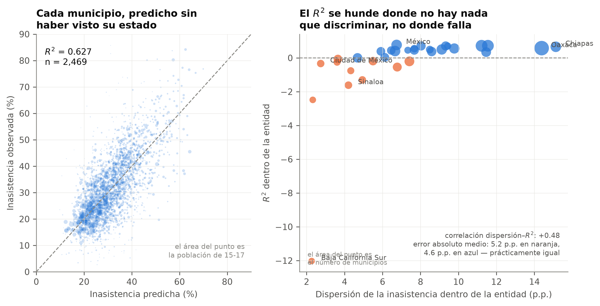

# Gaps in Access to Upper-Secondary Education in Mexico

A replicable model that identifies the municipalities with the largest gap in access to upper-secondary education, built only from open data and validated on states that took no part in its training.

It covers all **2,469 municipalities** and **189,432 localities** in the country.

---

## Main result

A model that uses only structural conditions of each territory (distance to schools, poverty, social deprivation, settlement dispersion, labor market and housing) reaches an **out-of-sample R² of 0.627** when predicting municipalities in states it never saw during training.

| Specification | Out-of-sample R² | Mean absolute error |
|---|---|---|
| Baseline: national mean | 0.000 | 7.63 |
| Baseline: mean of the municipality's own state | 0.112 | 7.31 |
| Structural, ridge regression | 0.526 | 5.27 |
| **Structural, gradient boosting** | **0.627** | **4.55** |
| Extended, with non-attendance at ages 12 to 14 | 0.830 | 2.99 |



Each fold holds out **whole states**. Random cross-validation would have inflated the result, because neighboring municipalities share conditions and the model can memorize regions.

## Three findings worth highlighting

**Targeting by rate reaches fewer students than choosing at random.** Ranking municipalities by non-attendance rate and selecting the top decile reaches 9% of out-of-school teenagers, below the 10% a random selection would give, because the municipalities with the highest rates have small populations. Ranking by absolute numbers captures 59%. These are two different policies.

**The municipal dropout rate from the Formato 911 school census is not suitable for territorial analysis.** It yields an adjusted R² of 0.002 in cross-section and 0.017 in panel. There are two documented causes: municipalities with fewer than 300 students have a standard deviation of 6.78 points between school years, and the census assigns each student to the municipality of their school rather than their residence.

**Distance to school has a causal effect but a small aggregate margin.** Each additional kilometer reduces attendance by 1.70 percentage points, and a symmetric falsification test rules out alternative explanations. However, closing every distance gap in Guerrero would recover only 1.66 points, because policy has already closed most of that gap.

---

## Reproducing the results

```bash
uv venv && uv pip install -r requirements.txt
```

The raw data (785 MB) is not versioned. Download it with:

```bash
.venv/bin/python src/00_descargar.py
```

The script checks each file against the SHA-256 recorded in `datos/crudo/MANIFIESTO.csv`, so you get exactly the data set used to produce these results. Open-data portals replace files without version control, which is why the manifest is part of the repository.

Then run, in order:

```bash
for s in 01_puente_municipios 02_abandono 03_cruce 04_distancia \
         05_asistencia_censal 06_localidades 07_subsistemas 08_figuras \
         09_brecha_restante 11_alerta_temprana 12_nacional 13_modelo_riesgo \
         14_figuras_nacional 10_pdf 15_docx; do
  .venv/bin/python "src/$s.py"
done
```

## Structure

```
src/      numbered pipeline; each script's header documents what it decides,
          what it assumes and which limitation it keeps
docs/     APA 7 manuscript, literature review, results and the design of the
          student-level early warning system
datos/    limpio/ holds the analytical outputs; crudo/ only the manifest
salidas/  manuscript PDF and 300 dpi PNG figures
```

Files of immediate interest (in Spanish):

- `datos/limpio/riesgo_municipal.csv`: the 2,469 classified municipalities, with observed and predicted non-attendance and the gap between them.
- `salidas/Articulo_APA7.pdf`: the full manuscript.
- `salidas/Articulo_APA7.docx`: the same manuscript as an editable Word file. Both are generated from `docs/ARTICULO.md`, so a correction is made once and both versions are rebuilt.
- `docs/ALERTA_TEMPRANA_UAGRO.md`: the design of a student-level early warning system, the level at which an alert can actually be acted on.

## Sources

All three are open access and cited in the manuscript:

- **INEGI**, 2020 Population and Housing Census, Main Results by Locality (ITER).
- **SEP**, Formato 911, school years 2019-2020 to 2024-2025.
- **CONEVAL**, 2020 Social Deprivation Index and municipal poverty measurement.

## Environment

**Technologies:** Python, pandas, NumPy, SciPy, scikit-learn, statsmodels, Matplotlib and LaTeX.

Python 3.12.3, NumPy 2.5.3, pandas 3.0.6, SciPy 1.18.1, scikit-learn 1.9.1, statsmodels 0.15.0. The PDF is compiled with pdfLaTeX.

## License

The code is released under the MIT license (see `LICENSE`). The data belongs to the institutions that publish it and is governed by their own terms; the datos.gob.mx data sets used here are under CC BY 4.0.

## Citation

Mariano Ruiz, E. D. (2026). *Identificación de municipios con rezago en el acceso a la educación media superior: un modelo replicable con datos abiertos para México* [Unpublished manuscript]. Facultad de Ingeniería, Universidad Autónoma de Guerrero.
